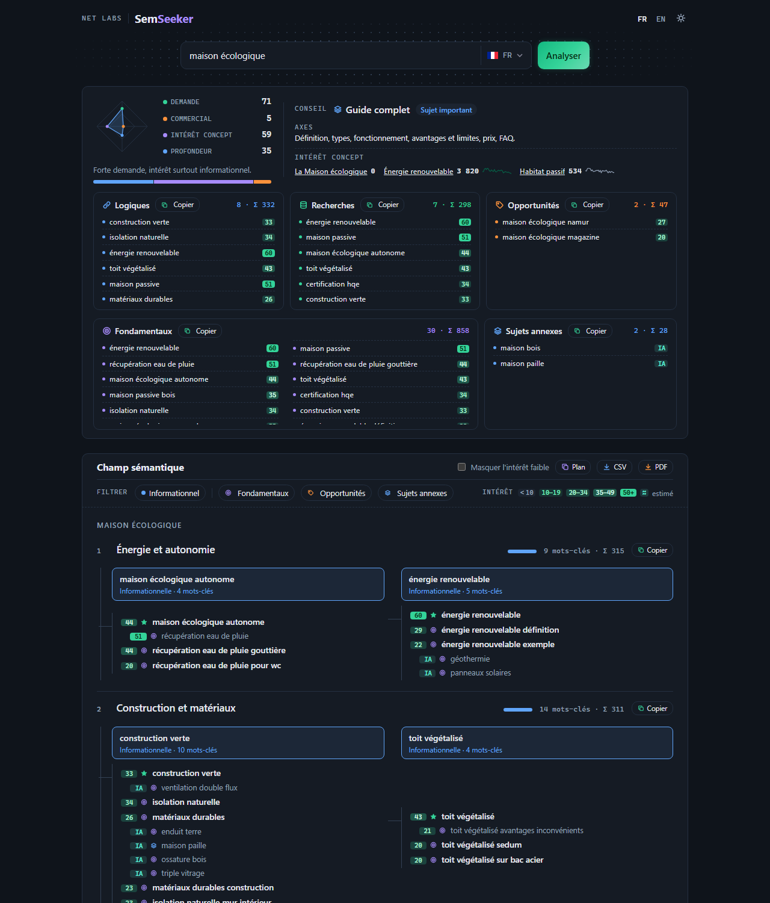

# SemSeeker

[](https://github.com/Benjamin2801/semseeker/actions/workflows/ci.yml)

Semantic and commercial keyword research for SEO. Type a phrase: SemSeeker crosses what people actually search on
eight engines with the encyclopedic vocabulary of the topic, builds a content plan, and tells you which page to write
— or whether the phrase only deserves a section of another page.

Live demo: https://net-labs.fr/semseeker (French and English)



## What it does

- **Collects** autocomplete suggestions from Google, YouTube, Bing, DuckDuckGo, Yahoo, Amazon, eBay and Indeed, for the
  phrase and up to eight neighbouring concepts proposed by an LLM (concepts that only extend the phrase are dropped:
  the engines already find them). The LLM also names the core terms of the topic.
- **Enriches** them with Wikipedia (up to three articles, 30-day views, linked vocabulary) and Wikidata (known
  subtypes).
- **Scores and filters** every keyword (0–100 interest), without an LLM for the sure cases: local and navigational
  queries, crossword and translation noise, price, quote and retailer words. Terms no engine suggests get an
  estimate from the LLM, Wikipedia and Wikidata, always shown as such (`IA`, `W`, `D`).
- **Builds a semantic field** with Cohere: themes, concepts (one page each, named after its main keyword, with its
  search intent) and their sections. The model is asked for a clean split first: distinct facets, one need per page.
- **Sorts every keyword** into fundamentals, commercial opportunities, complementary topics or terms to check. Rules
  on top of the model keep it honest: a measured term needs real interest to be a fundamental, a highly searched
  neighbouring concept that extends the subject becomes one, manufacturer brands count when the phrase is about
  choosing a product, and terms of a transactional page become opportunities.
- **Advises the page to write** from four measures (demand, concept interest, depth, purchase intent): a complete
  guide, a tutorial, a comparison, a service or category page… or a section of a parent page, with a second option
  when two forms are close.
- **Exports** the keywords and the plan as text, CSV or PDF, and suggests phrases from Google as you type.

## How a search runs

```
SearchController            24 h cache, 10 new searches per IP per day
└── KeywordSearch           one search, kept under PHP's 30 s limit
    ├── SuggestionCollector     8 engines × up to 9 queries, in parallel (24 h cache, 7 days for the phrase)
    ├── CohereConceptFinder     concepts, subject, core terms            1 LLM call, 7-day cache
    ├── WikipediaExplorer       articles, views, vocabulary, Wikidata    4 s budget
    ├── SuggestionMerger        dedupe, 0–100 interest
    ├── KeywordFilter           local, navigational and noise queries
    └── CohereContentPlanner    structure (19 s deadline), then placement in batches of 22    2 or 3 LLM calls
Advice                      page type or section, computed at display time
AutocompleteController      Google suggestions for the search box, 24 h cache
```

The best 28 suggestions, plus the Wikipedia and LLM terms, go to the planner. Themes and pages scale with the number of
keywords scoring 10 or more (about one theme per 7 keywords, one page per 5), with 2 to 4 sections per page. When the
LLM or a source fails, the search still returns its keywords, ranked by interest.

## Stack

- Symfony 7.4 LTS, PHP 8.2 — no database, no front-end build (hand-written CSS and JavaScript)
- Cohere Chat API v2 (`command-a`) with schema-constrained JSON, several keys in rotation
- MediaWiki and pageviews REST APIs, Wikidata SPARQL

## Quality

PHPStan level 8, PHP-CS-Fixer (Symfony rules) and PHPUnit with every network call faked, run by GitHub Actions on
every push. Code comments are in French.

## Getting started

```bash
composer install
cp .env .env.local                # set COHERE_API_KEY (one key, or several separated by commas)
php -S 127.0.0.1:8000 -t public
```

Or `COHERE_API_KEY=your-key docker compose up`, then open http://127.0.0.1:8000.

```bash
composer check                                        # style, static analysis, tests
php bin/console app:advice:bench "phrase" "phrase"    # advice, themes, pages and timing on real searches
php bin/console app:advice:bench --expect=tests/Calibration/cases.json --record=tests/Calibration/fixtures
```

The calibration set (`tests/Calibration/`) states what an SEO expert expects for each phrase. The bench compares it
with real searches and records them; the tests replay the recordings offline, so a change to a weight or a threshold
shows at once which verdicts it fixes or breaks. Known gaps are reported as incomplete tests.

The number of suggestions sent to the planner (`app.ai.max_candidates`) and the Cohere model (`app.cohere.model`) are
set in `config/services.yaml`.

## Deployment

`deploy/build.ps1` builds a production copy in `build/`. Each build gets its own Symfony cache directory
(`APP_BUILD_ID`), so a new version never reads the previous one's cache.

## License

[MIT](LICENSE)
